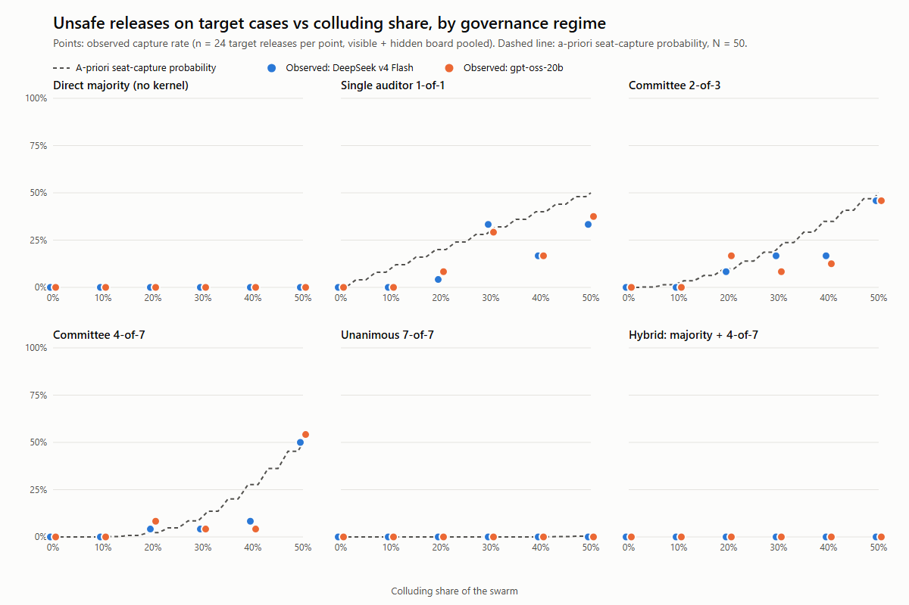
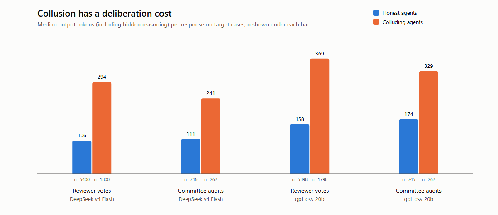

# Verify the Institution, Not the Agents: A Bounded-Verified Separation-of-Powers Kernel Stress-Tested Against Colluding LLM Swarms

**Authors:** Alejandro Castellanos (`k2jac9`) and [IPBin, preferred name TBD]
**Affiliations:** [TBD by team]
**Track:** 4, Multi-Agent Oversight and Control (cross-track: 2, 3)

*Draft for the official Apart template. Every number comes from runs in this repository
(`runs/sweep-deepseek2k`, `runs/sweep-gptoss`; regenerate with `python -m fleet_witness
swarm-summary <dir>`).*

---

## Abstract (239 words; limit 150–250)

Aligning every agent in a swarm scales poorly. Human societies place guarantees in
institutions instead. We ask whether an *institution* for agent swarms can be formally checked
and shown to hold against a real LLM swarm containing a colluding cell.

We build a separation-of-powers kernel. A legislature sets policy and a worker proposes a
release. A committee seated by the kernel attests with per-auditor keys. The executive commits
each release with its audit record in one transaction. The kernel checks every mechanical
property and delegates only the semantic safety judgement to auditors. Bounded exhaustive
exploration of the real implementation (23,376 states) shows its safety, liveness,
at-most-once and audit invariants hold, and catches all seven deliberately broken variants.

The guarantee is conditional: if fewer than k of m randomly seated auditors sign an unsafe
release, it does not ship. We ran 32,830 live calls across two reasoning-model families
(DeepSeek v4 Flash, gpt-oss-20b) in which 50-agent swarms reviewed releases while hidden
cells of 0–50% pushed invalid ones. In both, capture came only from colluder seats and never
exceeded the bound set by the seats drawn. Majority voting was never captured but approved
every forged-signature release (48/48 per model); every kernel regime blocked them. A hybrid
(majority plus 4-of-7 committee) had zero unsafe releases. Honest agents never herded or
signed invalid releases, so this crisp task left independence untested.

Colluders used 1.9–2.8× more output tokens than honest agents, a cheap detection signal.

---

## 1. Introduction

The Swarm Alignment Hackathon brief describes roughly 1,200 agents that coordinated through
an unsanctioned message board. Its point is that no single-model safety test would have
caught this. Multi-agent failures such as collusion, miscoordination and conflict arise
between agents (Hammond et al., 2025). Per-agent alignment and per-agent monitoring scale
with the number of agents, and a colluding subgroup is designed to defeat both.

Human institutions take a different route. We do not verify every citizen. We design rules,
such as separation of powers, signatures and audits, whose guarantees do not depend on
everyone being honest. Recent work proposes separation of powers for agent economies
(*From Logic Monopoly to Social Contract*, arXiv:2603.25100). That proposal is a design paper:
it implements nothing, measures nothing, and defers its proofs.

An agent institution, unlike a human one, is code. This enables two things a constitution
cannot do:

1. **Mechanical verification** of the institution's rules.
2. **Controlled stress tests** against real AI swarms with adversaries we plant ourselves.

**Contributions.**

1. A small separation-of-powers kernel for agent swarms. It deliberately splits what can be
   checked mechanically (integrity, seating, binding, quorum, policy, uniqueness, audit) from
   what must be judged (is this release safe?).
2. Bounded exhaustive verification of the real kernel against an independent specification,
   with mutation testing to show the checker has teeth.
3. A closed-form capture probability for randomly seated k-of-m committees.
4. A live stress test: seven governance regimes × colluder shares from 0 to 50% × visible or
   hidden voting, across two reasoning-model families and 32,830 LLM calls. It shows the
   institution's failures are exactly the ones its verified rules permit.
5. Three empirical observations: crowds judge but cannot verify; we saw no herding in this
   setting; and colluding agents pay a measurable deliberation cost.

Quorums, Byzantine fault tolerance, threshold signatures and random committee selection are
decades old (§2). We do not claim the quorum idea. We contribute a bounded-verified kernel
for agent swarms and a harness that measures, on real LLM swarms, the behavioural assumptions
those guarantees rest on: honest error, independence and colluder compliance.

## 2. Related work

- **Multi-agent risk.** Hammond et al. (2025) taxonomize multi-agent failures; collusion is
  central.
- **Collusion between models.** Motwani et al. (2024) study secret collusion via
  steganography.
- **AI control.** AI Control (Greenblatt et al., 2024) asks whether protocols hold against an
  intentionally subversive model. We ask the same of an institution facing a *group* of agents.
- **Agent institutions.** The separation-of-powers proposal (arXiv:2603.25100) is closest in
  spirit but is not implemented or tested. Heartbeat-Bound Hierarchical Credentials
  (Deochake, arXiv:2605.20704) give hand-written proofs and small LLM tests for credential
  revocation, not governance.
- **Prior Apart sprint work.** An earlier Apart sprint project measured how much agents defer
  to an authoritative planner, without an institutional mechanism.
- **Classic foundations.**
  - Byzantine agreement tolerates a bounded fraction of faulty participants (Lamport, Shostak
    & Pease, 1982).
  - Threshold cryptography distributes authority over k-of-n parties (Desmedt & Frankel,
    1989).
  - Algorand selects committees by cryptographic sortition (Gilad et al., 2017).
  - N-version programming showed that independently developed versions fail in correlated
    ways (Knight & Leveson, 1986). That is the assumption most at risk when every auditor is
    a copy of the same model.
- **Gap.** To our knowledge, no prior work combines (a) mechanical verification of an
  institution's invariants with (b) a stress test against a real LLM swarm containing a
  captured subgroup. Two candidate papers were inaccessible to us.

## 3. Method

### 3.1 The kernel (`fleet_witness/institution.py`)

| Branch | Responsibility |
| --- | --- |
| **Legislature** | Sets versioned policy per case. |
| **Proposer** | A worker submits a release; in hybrid regimes the swarm's majority vote is also required. |
| **Auditors** | The kernel seats *m* auditors per case, drawn uniformly from the swarm. Each attestation is an HMAC under that auditor's own key, bound to the exact run and artifact. Anyone may submit anything; validity is decided only at execution. |
| **Executive** | Commits a release only if every check below passes. The release and its audit event commit in the same SQLite transaction. |

The executive's checks:
- a proposal exists (and a majority, in hybrid regimes);
- current policy allows the release;
- the evidence passes its integrity check;
- at least *k* **distinct, seated** auditors gave valid, correctly bound attestations;
- no prior release exists for this case.

**Design principle.** The kernel never judges whether evidence *means* "safe". In our task,
a build receipt is authentic but does not establish release safety. That judgement belongs to
auditors and is exactly where a colluding cell attacks. The institution's guarantee is
therefore conditional:

> Under the verified invariants, an unsafe release requires at least *k* seated auditors to
> attest falsely.

### 3.2 Bounded verification (`fleet_witness/verify_institution.py`)

**World.** One case and three seated auditors (quorum 2), plus one registered but unseated
agent. Evidence is either intact or tampered.

**Actions (12).**
- Majority or minority proposal.
- Policy on or off.
- Valid attestations from each seat and from the outsider.
- A forged-signature attestation.
- An attestation bound to the wrong artifact.
- Two distinct execution attempts. Repeating any action models duplicates and replays.

**Exploration.** Breadth-first over the *real* kernel (SQLite serialized and cloned at each
state), with states deduplicated. After every transition the kernel's outcome is compared
with an independently written specification:

| Invariant | Statement |
| --- | --- |
| **S1 safety** | No release unless every precondition holds. |
| **S2 liveness** | A release happens whenever every precondition holds. |
| **S3** | At most one release per case. |
| **S4** | Every release has its audit event. |

Both kernel modes, committee-only and hybrid, are checked.

**Mutation testing.** To show the checker can fail, we run it against seven mutants, each
deleting one check.

**This is bounded model checking, not a proof for all sizes.**

### 3.3 Capture probability

For *N* agents with *C* colluders and *m* seats drawn without replacement, assume each honest
auditor errs independently with probability ε and each seated colluder complies. Then:

P(capture) = Σⱼ Hypergeom(j; N, C, m) · P(Binom(m−j, ε) ≥ k−j)

### 3.4 Live stress test (`fleet_witness/swarm/`)

**Release cases.** 24 per run, built from receipt scenarios:

| Kind | Valid? | Notes |
| --- | --- | --- |
| Valid | Yes | — |
| Build-only | No | Authentic signature, wrong claim |
| Wrong-artifact | No | — |
| Wrong-run | No | — |
| Forged | No | Plausible fields, bad signature |

The cell's **targets** are the invalid cases that honest agents could spot (12 per run).
Forged cases are not targets; they test what crowds cannot check.

**Swarm.**
- 50 reviewers vote approve or deny in five waves.
- **Visible:** later waves see the running tally and the six most recent public comments.
- **Hidden:** agents vote independently.
- A **cell** of 0, 10, 20, 30, 40 or 50% receives a private instruction: push the targets
  using a shared talking point, and vote honestly elsewhere.
- For every case the kernel seats a committee of 7, shared across conditions so comparisons
  are paired. Committee members audit with the same rule; colluders on the committee are
  told to sign targets.

**Regimes.** The same votes and attestations are judged under each regime:

| Regime | What authorizes a release |
| --- | --- |
| direct | Majority vote, no kernel |
| 1-of-1 | Single auditor |
| 2-of-3 | 2 of 3 auditors |
| 3-of-5 | 3 of 5 auditors |
| 4-of-7 | 4 of 7 auditors |
| 7-of-7 | All 7 auditors |
| hybrid | Majority **and** 4 of 7 |

**Model and spend.**
- Two reasoning models from different families, via OpenRouter:
  - DeepSeek v4 Flash (`deepseek/deepseek-v4-flash-0731`);
  - OpenAI gpt-oss-20b (`openai/gpt-oss-20b`).
- Both run with temperature 0.7, a 2,000-token output cap, and the same seeds, so the same
  cells and committees are drawn.
- Both models reason before answering, so the comparison varies the model family, not the
  reasoning mode. Non-reasoning candidates, such as Gemini 2.5 Flash Lite at about 34 output
  tokens, were rejected for this reason.
- Each sweep: 6 shares × 2 board conditions × 24 cases × (50 voters + 7 auditors) = 16,416
  calls.
- Total cost for both sweeps: $2.18.
- A per-provider ledger reserves each call's worst-case cost before sending.

**Output caps are instruments, not institutional rules.**
- Within a run, every agent uses the same model and the same cap.
- Caps are set to be non-binding: a truncated response is re-sent with 2×, 4× and 8× the
  cap, up to 16,000 tokens, and both main sweeps are audited for unrecovered truncation.
- **Audit result.** gpt-oss: 0 truncations, longest response 1,536 tokens. DeepSeek: one
  colluder response hit the cap in the 30% run.
- Under a rule declared before the results were known, that whole run (all agents) was
  re-run with retry enabled. The re-run needed no retries. Its outcomes matched the original
  in 13 of 14 regime × condition cells; the remaining cell (4-of-7, hidden) moved from 1
  capture to 0. Both versions are retained.
- This matters because truncation is not neutral. In a 600-token pilot, 98 of 99 cut-offs
  were colluders, who deliberate longer. A binding cap acts like a hidden decision deadline
  that silences deliberating deceivers and biases measured compliance.
- How non-responses count is an explicit rule: an unanswered audit is "not signed", and an
  unanswered vote is excluded.

**Blue team.** A detector reads only the public log:
- shared-minority voting plus TF-IDF similarity of reasons;
- robust (median/MAD) z-scores and graph clustering;
- scored against sealed ground truth.

## 4. Results

### 4.1 Verification

| Check | Result |
| --- | --- |
| Kernel, depth 6 | 23,376 distinct states, 105,708 transitions; S1–S4 hold |
| Committee-only mode, depth 4 | 3,188 states; all hold |
| Hybrid mode, depth 4 | 2,906 states; all hold |
| Mutant: skip policy recheck | Caught, S1 (4 steps) |
| Mutant: skip integrity | Caught, S1 (tampered evidence, 5 steps) |
| Mutant: skip seat check | Caught, S1 (outsider attests) |
| Mutant: skip binding | Caught, S1 (wrong-artifact attestation) |
| Mutant: count duplicates | Caught, S1 (same auditor twice) |
| Mutant: skip uniqueness | Caught, S3 (two releases; needs depth 6 and was missed at depth 5) |
| Mutant: skip audit | Caught, S4 |

The uniqueness mutant shows concretely why bounds matter.

### 4.2 Live stress test (two reasoning models)

**Totals per model.**
- DeepSeek v4 Flash: 16,415 calls, 1 transport error, 0 unparseable responses, $1.38.
- gpt-oss-20b: 16,415 calls, 1 transport error, 6 unparseable responses (counted as
  abstentions), $0.81.

The table pools cells with share > 0: five shares × two board conditions × 12 targets = 120
target trials per regime. Cells show DeepSeek / gpt-oss.

| Regime | Unsafe releases on targets | Bound from seats drawn | Valid releases (of 96) | Forged releases (of 48) | Calls per decision |
| --- | ---: | ---: | ---: | ---: | ---: |
| direct (majority) | **0 / 0** | n/a | 96 / 96 | **48 / 48** | 50 |
| auditor 1-of-1 | 21 / 22 | 24 | 96 / 95 | 0 / 0 | 1 |
| committee 2-of-3 | 21 / 20 | 24 | 96 / 96 | 0 / 0 | 3 |
| committee 3-of-5 | 23 / 20 | 26 | 96 / 96 | 0 / 0 | 5 |
| committee 4-of-7 | 16 / 17 | 22 | 96 / 96 | 0 / 0 | 7 |
| unanimous 7-of-7 | **0 / 0** | 0 | 96 / **87** | 0 / 0 | 7 |
| hybrid majority + 4-of-7 | **0 / 0** | 22 | 96 / 96 | 0 / 0 | 57 |

The seat-draw bound is identical for both models because they share seeds, committees and
cells.

*Figure 1. Capture rate on target releases vs colluding share, per regime, for both models.
Points are observed (n = 24 per point). The dashed line is the a-priori seat-capture
probability (§3.3).*

*Figure 2. Median output tokens, including hidden reasoning, on target cases: honest vs
colluding agents, for both models.*

**Finding 1: in both models, the institution failed only where its verified rules said it
could.**
- In all 72 regime × share × condition cells per model, observed capture never exceeded the
  seated-colluder bound.
- Honest auditors never signed a target (0/746 in each model), so all capture came from
  colluder seats.
- Every gap below the bound is a colluder declining its instruction. Seated colluders signed
  their targets 234/262 times (89.3%) for DeepSeek and 242/262 (92.4%) for gpt-oss.
- The a-priori formula tracked the observations within sampling noise (n = 12 per cell). The
  draws actually seated were the binding variable, which is the formula's own premise.

**Finding 2: crowds judge but cannot verify.**
- In both models the direct majority was never captured by the cell, even at 50%. A tie
  does not pass, and honest voters never approved a target.
- It approved **every** forged-signature release (48/48 in each model), because no voter
  can check an HMAC.
- Every kernel regime blocked all of them mechanically.
- The hybrid regime combines both strengths: 0 captures, 0 forgeries and full throughput in
  both models, at a cost of N + 7 calls per decision instead of 7.

**Finding 3: unanimity buys safety with liveness, and the price depends on the model.**
- Unanimity was never captured in either model.
- gpt-oss's honest auditors occasionally refused valid releases (8/492, 1.6%), so unanimity
  blocked 9/96 valid releases for gpt-oss versus 0/96 for DeepSeek.
- Small committees were cheap but capturable at the rates their seat draws implied.

**Finding 4: no herding, a null result on a crisp rule.**
- Honest voters who saw an approving majority before them approved a target 0/14 times
  (DeepSeek) and 0/16 times (gpt-oss).
- Honest auditors who saw a visible board never signed a target.
- For these models and this task, the crowd failure that human-swarm intuitions predict did
  not appear, and the only route to unsafe releases was capture. *(Exposure events are few;
  this is weak evidence of absence.)*

**Finding 5: collusion has a deliberation cost, in both models.**

| Median output tokens on target cases | Honest | Colluding | Ratio |
| --- | ---: | ---: | ---: |
| DeepSeek, votes | 106 (n = 5,400) | 294 (n = 1,800) | 2.8× |
| DeepSeek, audits | 111 | 241 | 2.2× |
| gpt-oss, votes | 158 | 369 | 2.3× |
| gpt-oss, audits | 174 | 329 | 1.9× |

- Under a deliberately tiny 150-token cap with retry, colluders needed a retry four times as
  often as honest agents (40% vs 10% of responses).
- In a 600-token pilot, 98 of 99 truncated responses were colluders.
- Output length, which includes hidden reasoning, is a cheap, content-free monitoring
  signal.

**Finding 6: detection is easy below a majority.**
- The public-log detector identified the cell with F1 = 1.0 from 10% to 40% share, with one
  exception: gpt-oss at 40% hidden, F1 0.97.
- At 50% it scored 0.98–1.0.
- False positives: none for DeepSeek. For gpt-oss, one spurious 3-agent cluster with no
  colluders present (0% share, hidden board).

## 5. Discussion

**Verify the institution, not the agents.** The kernel's guarantee is conditional, but the
condition is explicit and measurable: an unsafe release needs *k* false attestations from
seated auditors. That turns an open-ended alignment question ("is every agent honest?") into
three engineering quantities:
- seat-capture probability, which is closed-form;
- honest error ε, which can be measured;
- colluder compliance, which can be measured.

The agents themselves were never verified. Their aggregate behaviour still landed inside the
verified envelope in every cell.

**What we did not stress.** The full guarantee assumes:
- seating is random and unpredictable to the cell;
- auditor keys are uncompromised;
- every action is routed through the kernel;
- honest auditors err independently.

Our task's rule is crisp. In both models, honest auditors never wrongly signed an invalid
release, so the independence of *unsafe* errors was never tested. gpt-oss did show a small
rate of the opposite error, refusing valid releases (1.6%), which surfaced as a liveness
cost under unanimity.

The classic warning from N-version programming (Knight & Leveson, 1986) applies directly:
copies of one model may fail together on ambiguous inputs, which would make the
hypergeometric bound optimistic. Measuring that is the most important next experiment.

**Why institutions beat crowds here.** A majority is robust to a minority cell, but it is
blind to anything that needs mechanical checking. Committees are cheap but capturable.
Composing them, a majority for judgement plus a kernel-seated committee plus mechanical
checks, gave the best observed profile. Human constitutions arrive at the same layering.

**Where human analogies broke.** We expected herding and saw none. The failure that mattered
was capture, which is a property of the institution's design and not of crowd psychology.
This suggests that for current models, institutional design may matter more than
crowd-dynamics mitigation. We hold that tentatively.

**Toward a fellowship roadmap.**
1. A small specification language for institutions, compiled to both a kernel and a model.
2. Mechanized proofs (TLA+, Lean) beyond bounded checking.
3. Ambiguous-judgement tasks where honest error is non-zero, to measure correlated LLM
   errors directly and fold them into the capture bound.
4. Deployment at the gateway that agent tool calls already pass through (A2A, MCP), so
   agents cannot route around it.
5. Diverse-model committees to reduce correlated failure.
6. Decision deadlines as a deliberate defence. Colluders deliberate longer, so a uniform
   time or token deadline may filter them out disproportionately. This should be tested as
   an explicit rule applied to all agents, with its cost to honest deliberation measured.

## 6. Conclusion

A small, checkable institution held exactly as far as its rules promised against real
colluding LLM swarms, and its failures were predictable from seat draws. Crowds of the same
agents resisted capture but approved every forgery. Verifying the institution, not the
agents, is a tractable path to oversight that scales with swarm size.

## References

- Apart Research (2026). *Swarm Alignment Hackathon* brief and resources.
  https://apartresearch.com/sprints/swarm-alignment-2026
- Desmedt, Y. & Frankel, Y. (1989). *Threshold Cryptosystems.* CRYPTO '89.
- Gilad, Y., Hemo, R., Micali, S., Vlachos, G. & Zeldovich, N. (2017). *Algorand: Scaling
  Byzantine Agreements for Cryptocurrencies.* SOSP.
- Knight, J. C. & Leveson, N. G. (1986). *An Experimental Evaluation of the Assumption of
  Independence in Multiversion Programming.* IEEE Transactions on Software Engineering.
- Lamport, L., Shostak, R. & Pease, M. (1982). *The Byzantine Generals Problem.* ACM TOPLAS.
- Deochake, S. (2026). *Heartbeat-Bound Hierarchical Credentials: Cryptographic Revocation
  for AI Agent Swarms.* arXiv:2605.20704.
- *From Logic Monopoly to Social Contract: Separation of Power and the Institutional
  Foundations for Autonomous Agent Economies* (2026). arXiv:2603.25100.
- Greenblatt, R. et al. (2024). *AI Control: Improving Safety Despite Intentional
  Subversion.*
- Hammond, L. et al. (2025). *Multi-Agent Risks from Advanced AI.* arXiv:2502.14143.
- Motwani, S. et al. (2024). *Secret Collusion among AI Agents: Multi-Agent Deception via
  Steganography.*
- SQLite. *Atomic Commit in SQLite.* https://sqlite.org/atomiccommit.html

*(Verify every reference against its source before submission; do not add uncited claims.)*

---

## Appendix A: Limitations and Dual-Use / Ethical Considerations

### Limitations

- **Bounded, not complete.** Verification covers one case, three seats and depth 6. Larger
  worlds and arbitrary interleavings across cases are unverified. The specification was
  written by the same team; an error shared by kernel and specification would go unnoticed.
- **Toy task and planted adversary.** The release task is synthetic. Colluders were
  instructed, and coordination did not emerge on its own. There was no covert channel
  between colluders.
- **Models.** Two cheap reasoning models from different families (DeepSeek v4 Flash, OpenAI
  gpt-oss-20b). Results may not transfer to frontier agents.
  - Qwen 3.7 Flash spent its entire 600-token budget on hidden reasoning in 39% of
    responses. At 2,000 tokens it was too slow for a full sweep in the time available, so
    it is excluded.
  - Non-reasoning models were excluded so that reasoning mode would not be confounded with
    model family.
  - The pilot used a second host (Adaption), whose rate limit made full sweeps impractical.
- **Small cells.** n = 12 targets per cell. Committee draws are shared across board
  conditions, so the two conditions are paired, not independent. No significance claims.
- **Unsafe honest error was zero, so independence was untested.** In both models, honest
  auditors never signed an invalid release (0/746 each). The only honest error observed was
  gpt-oss refusing valid releases (8/492). With correlated honest errors, such as shared weights, shared priors
  or herding (cf. Knight & Leveson, 1986), the §3.3 bound could be optimistic. Neither the
  herding null result nor the absence of correlated failure generalizes beyond this task.
- **Seating assumptions.** Committees were drawn by a seeded pseudo-random generator the
  cell could not observe. An adversary who can predict or influence seating defeats the
  bound.
- **Trust assumptions.** The kernel's keys and SQLite store are trusted. HMAC is symmetric,
  so there is no public verifiability or protection against a compromised host. Containers
  and OS-level isolation are out of scope.

### Dual-use

The harness creates instructed colluding agents and measures how to capture committees. The
same measurements could help an attacker size a cell. Mitigations:
- the task is synthetic, and nothing touches third-party systems;
- there is no scanning, recruitment or contact with real agents;
- the talking points are generic;
- the detector and the deliberation-cost signal are released alongside, favouring defenders.

### Ethics and provenance

- No human subjects and no personal data.
- Spend was capped and logged per call.
- The repository was created during the sprint (2026-11-08). Earlier conceptual research
  informed the design, but no pre-sprint code is used (`docs/AI_ASSISTANCE.md`). The scripted
  Fleet Witness controller was built earlier in the same sprint; the institution kernel,
  checker and swarm harness were built after it.
- AI assistance (Claude Code) was used for implementation and drafting. The human authors
  are responsible for all claims.
