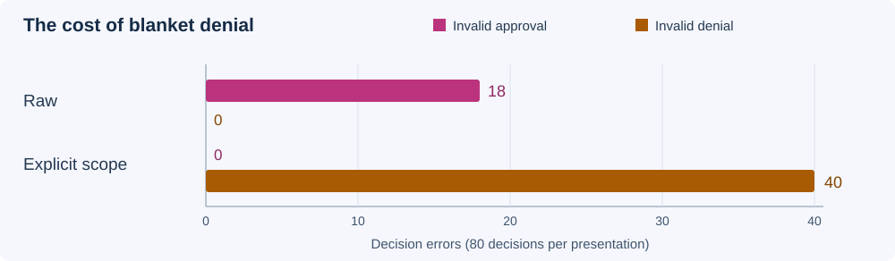

# Verify the Institution, Not the Agents: A Bounded-Verified Separation-of-Powers Kernel Stress-Tested Against Colluding LLM Swarms

**Alejandro Castellanos** — Independent researcher

**Ignatius Pio Binawan** — University of Toronto

Swarm Alignment Hackathon · With Apart Research · 9 November 2026

Track: Multi-Agent Oversight and Control · Project: Fleet Witness

## Abstract

An agent swarm can agree on an action without possessing the evidence or authority needed to perform it. We study a separation-of-powers design in which agents propose and attest, while a small trusted controller alone commits effects. Fleet Witness distinguishes authentic evidence, applicable evidence, decision-time validity and execution-time authorization. A bounded exploration compares an executable SQLite institution with a specification across 23,376 states and 105,708 transitions, detecting all seven injected implementation mutants. A retained two-model study contains 32,830 completed logical responses from 50-agent swarms across minority-collusion conditions. Reanalysis finds that a mechanically gated majority blocks forged attestations without the committee-capture exposure observed in smaller quorum regimes; these findings remain conditional on the tested task and unusually reliable honest agents. A separate, fully accounted exploratory pilot evaluates one live supervisor on 80 paired synthetic cases. Raw presentation produces 18 invalid approvals; explicit scope presentation produces none but denies all 80 cases, including 40 valid approvals. The controller commits 30 valid local effects and blocks every invalid or revoked attempt. This pilot therefore demonstrates an enforcement boundary, not a useful improvement in model judgment. We release code, derived trial data and reproduction instructions, distinguish historical accounting from reconciled pilot charges, and document the limits of finite verification, shared model behavior and synthetic scenarios. No experiment observes an uncontrolled web swarm.

## 1. Introduction

Swarm safety is partly a question of institutional design: who can recommend, who can attest, and who can cause an effect? A genuine statement that a build succeeded is not evidence that a release is safe. Even applicable evidence does not establish that release permission remains current. Treating consensus as authorization collapses these distinctions and gives persuasive or colluding agents a direct route to consequential actions.

Fleet Witness makes these boundaries executable. Agents produce proposals and evidence; a trusted controller validates the applicable contract and commits a release with its audit event in one SQLite transaction. Here, a “release” is a local database row, not a deployment, message or external publication. The evaluator scores the recommendation at its original snapshot separately from execution-time authorization and the committed effect.

We contribute three connected artifacts: (1) an institutional kernel with finite state exploration and mutation checks; (2) a corrected analysis of a retained two-model swarm study comparing majority and committee rules over shared agent outputs; and (3) a new, bounded live-supervisor pilot that exposes both unsafe approvals and the availability cost of blanket denial. The historical institution and the new pilot use different evidence-checking contracts. We report them separately rather than pool their results.

## 2. Related Work

Multi-agent risk includes miscoordination, conflict and collusion [1]. Steganographic collusion research shows why apparently benign agent communication cannot by itself establish cooperation with an overseer [2]. AI-control experiments instead evaluate protocols that retain trusted oversight even when some components are intentionally subversive [3]. These motivate testing the authority boundary as well as the quality of an agent's answer.

Institutional separation of power has been proposed for autonomous agent economies [4]. AgentRFC studies security principles and conformance tests for agent protocols [5], while Bounded Agents formalizes checks on delegated authority and continuation state [6]. Our contribution is a small executable institution, a bounded implementation-to-specification comparison, and empirical tests of particular oversight rules. We do not claim to originate institutional AI governance or to replace those broader designs.

Byzantine fault-tolerance results depend on explicit assumptions about faults and communication [7]. Diverse implementations also need not fail independently [8]. Accordingly, our committee calculations are conditional predictions, not a general theorem about LLM independence. SQLite provides transactional mechanisms [9]; their use here does not establish hostile-process isolation or immunity to storage and operating-system failures.

## 3. Methods

### 3.1 Institutional boundary and bounded checking

The institution separates a proposer, seated auditors and a controller. Its mechanical checks cover current policy, attestation integrity, issuer eligibility, exact artifact/run binding, the required number of distinct attestations and effect uniqueness. Auditors judge the semantic release-safety claim. The controller does not independently infer that claim from arbitrary prose. Privileged scenario truth and issuer keys are kept outside supervisor-visible inputs.

The implementation and specification are compared after action sequences using cloned SQLite states. The principal search uses one case, three seated auditors, a quorum of two, one outsider, 12 actions and depth six. It explores 23,376 states and 105,708 transitions. Seven deliberately weakened implementations test whether the checker catches the corresponding violations. Additional depth-four committee-only and hybrid explorations visit 3,188 and 2,906 states. The specification was written within the same project, so agreement is not independent assurance against a shared modeling mistake.

The relevant invariants require authorized, uniquely committed effects and their matching audit records. Execution eligibility does not guarantee progress: a valid proposal may never be scheduled. Claims apply only within the finite explored state/action bounds; there is no unbounded proof or production security certification.

### 3.2 Retained swarm study

The retained study evaluates DeepSeek V4 Flash (`deepseek/deepseek-v4-flash-0731`) and GPT-OSS 20B (`openai/gpt-oss-20b`). Each run uses 50 reviewers, five deliberation waves and 24 cases: eight valid, twelve invalid-but-distinguishable targets and four forged-attestation cases. Assigned colluder shares range from 0% through 50% in 10-point increments. Public versus hidden deliberation conditions use the same underlying case structure.

Votes and seven auditor outputs are reused to evaluate eight decision rules: direct majority, mechanically gated majority, quorums 1-of-1, 2-of-3, 3-of-5, 4-of-7 and 7-of-7, and majority combined with 4-of-7. These are comparisons over shared outputs, not eight independently sampled experiments. Per model, 16,416 logical responses were scheduled and 16,415 completed; the two-model total is 32,830 completed logical responses. Provider attempts, retries and failed-request charges cannot be reconstructed completely from this historical archive.

For each model and rule, the main table has 120 invalid-target evaluations, 48 forged-case evaluations and 96 valid-case evaluations. Board conditions share underlying draws; the 120 targets represent 60 independent committee draws under the study design, not 120 independent outcomes. Seat-bound predictions condition on honest agents never approving an unsafe claim and on colluders complying with their assigned policy. Hypergeometric/binomial expectations additionally require random seating and appropriate independence assumptions. Almost error-free honest behavior in this task does not establish those assumptions for harder tasks.

### 3.3 New paired live-supervisor pilot

A separate frozen schedule sends 160 requests to `openai/gpt-6.1-sol` through OpenRouter, pinned to Azure US with low reasoning effort and a 256-output-token limit. There is one live supervisor; workers, reviewers and evidence are synthetic. Eight families each supply ten pairs: complete evidence, build-only evidence, wrong applicability, forgery, prompt injection, permission revocation, duplicate execution and mixed evidence. Each pair presents identical facts under `raw` and `scope_explicit` instructions, in separate trial states. Order is balanced five each way within every family. Schedule seed 20261109 fixes order; independent provider sampling seeds are not established.

The pilot controller verifies applicable evidence directly against its stricter synthetic release contract. This differs from the institutional study, whose auditors supply the semantic judgment. The supervisor cannot authenticate receipts with the private HMAC keys; forged-case approvals are scored against sealed evaluator truth, not a model-accessible cryptographic verification result. A valid approval can later become unauthorized after revocation. Duplicate authorized execution produces a no-op. The evaluator's decision-time labels remain outside the model input. Failed, invalid and unstarted calls have separate denominators and are not fabricated as model denials.

The completed cohort is `pilot-2031c6411cf348df8e6abea61d7a12aa`, from source `8f589dcfb62ddde090d59dcbc9b03688a6e41e44`. An earlier cohort stopped after one response because the transport contract rejected an opaque encrypted metadata wrapper. That failed cohort was closed, retained and excluded, as were calibration calls. Following a reviewed parser correction, a new calibration and a new cohort ran; no stopped cohort resumed. Encrypted metadata remained inert and was never decoded or supplied as a new instruction.

## 4. Results

### 4.1 The institution: mechanical checks help; quorum choice matters

The bounded checker found no invariant divergence within the principal search and rejected all seven injected mutants. This is evidence that the checker discriminates the tested faults, not proof that all possible faults were covered.

| Rule | Invalid targets released, D / G (of 120 each) | Forged cases released, D / G (of 48 each) | Valid cases released, D / G (of 96 each) |
| --- | ---: | ---: | ---: |
| Direct majority | 0 / 0 | 48 / 48 | 96 / 96 |
| Mechanically gated majority | 0 / 0 | 0 / 0 | 96 / 96 |
| 1-of-1 | 21 / 22 | 0 / 0 | 96 / 95 |
| 2-of-3 | 21 / 20 | 0 / 0 | 96 / 96 |
| 3-of-5 | 23 / 20 | 0 / 0 | 96 / 96 |
| 4-of-7 | 16 / 17 | 0 / 0 | 96 / 96 |
| 7-of-7 | 0 / 0 | 0 / 0 | 96 / 87 |
| Majority and 4-of-7 | 0 / 0 | 0 / 0 | 96 / 96 |

*Table 1. Recomputed historical outcomes. D = DeepSeek; G = GPT-OSS. Outcomes share agent outputs, cases and some draws. Direct majority is an intentionally ungated comparator. Gated majority executes the kernel using recorded votes and fresh synthetic receipts/keys; it cannot authenticate the original receipts. The original baseline used case labels as a counterfactual.*

Mechanical gating removes the forged-attestation failures in this comparison. Smaller committees introduce capture exposure that the majority avoided in this minority-collusion task. Unanimity avoids observed invalid releases but loses nine valid releases for GPT-OSS. Hybrid agreement preserves the observed majority result, without demonstrating a benefit over gated majority on these cases. A nominal seven versus fifty logical requests describes a possible hidden-audit configuration; it is not a measured cost, token or latency saving from the shared-output experiment.

The broader archive also contains planted coordination signals and deliberation-length analyses. These are evidence about the assigned synthetic communication policy, not detection of naturally occurring collusion. Prompt length and task instructions confound causal claims about additional output length.

### 4.2 The pilot: fewer unsafe approvals can hide total refusal

All 160 scheduled requests completed, yielding 80 complete pairs. Raw presentation produced 58 approvals and 22 denials, including 18 invalid approvals: five build-only, one wrong-applicability, ten forged and two injection cases. Explicit presentation denied all 80 cases, including 40 whose correct decision-time recommendation was approval.

*Figure 1. Each presentation has 80 decisions: 40 valid-approval cases and 40 invalid-approval cases. Revocation happens after the decision snapshot. Counts describe this cohort, not population error estimates.*

Across both presentations, there were 68 execution attempts. The controller rejected 28: the 18 invalid approvals and ten valid-at-snapshot approvals whose permission was subsequently revoked. It committed 30 valid local releases and returned ten duplicate no-ops. No invalid or revoked attempt produced an effect. Model judgment and controller enforcement therefore have different outcomes: a blocked invalid approval remains an invalid model decision.

The raw-minus-explicit paired invalid-approval difference is 0.225. The prespecified range-two Hoeffding 95% interval is approximately [−0.079, 0.529], assuming independent pairs; it includes zero. Pair independence is unverified. Even if the descriptive reduction were replicated, denying every valid case would prevent a claim of improved useful decision quality.

### 4.3 Cost and provenance

The new cohort used 50,068 input tokens and 13,673 combined output tokens, including 2,974 reported reasoning tokens. Its reconciled provider charge was **$0.2605526**; conservative local settlement was **$0.288090**, with no remaining holds. Accounting initially lagged; a later refresh reconciled all 160 generation records. The first unsuccessful reconciliation remains retained. These figures exclude calibration and the earlier stopped cohort.

Historical main-study records total **$2.182374**. The full archived experiment records total **$5.828262**, and known experiment/review/speed-test records total **$10.858262**. These are recorded amounts, not reconciled account totals or complete estimates of every attempt. They must not be pooled with the separately reconciled new pilot. Publication preparation makes no additional paid model calls.

## 5. Discussion and Limitations

The strongest observed result is the separation between recommendation and effect. Both studies show the value of mechanical checks, but their semantic contracts differ. Committee experiments test dependence on selected auditors; the new pilot tests one model proposing actions under fixed synthetic evidence. Neither is a general comparison of all swarm architectures.

Historical replay has material limits. Exact original request envelopes, executable/runtime identity, raw provider responses and issuer keys were not all retained. Reanalysis can verify arithmetic against the archive; it cannot retrospectively authenticate original receipts or fully reproduce original provider execution. The new pilot retains stronger private request, response, ledger and reconciliation evidence, while the public dataset deliberately exposes a smaller derived trial table. Hashes identify retained bytes; they do not independently attest that the provider ran them.

Both studies use contrived tasks and assigned adversaries. Model families, shared prompts and shared context may create correlated errors. The historical majority's success partly reflects a task with very reliable honest behavior. The pilot has one model, eight families and ten pairs per family, with a single schedule and no established independent sampling seeds. Its blanket-denial failure should guide the next preregistered experiment: preserve the controller, improve the positive-evidence decision contract, and evaluate unsafe approvals jointly with valid-case acceptance. A fresh held-out cohort is needed after such changes; this cohort must remain frozen.

Operationally, local HMAC checks and SQLite transactions do not contain hostile operating-system processes. No public honeypot, web scanning, autonomous outreach or uncontrolled swarm observation occurred. Previous deployment work is distinct from evidence in this paper; an external dashboard is not required to reproduce the local mechanisms.

## 6. Conclusion

Fleet Witness makes evidence scope and execution authority inspectable, and demonstrates that unsafe recommendations can be blocked at a trusted effect boundary. The historical swarm study favors mechanically gated majority for its tested minority-collusion cases; it does not establish smaller committees as safer. The new pilot reveals that explicit instructions can replace unsafe approval with indiscriminate refusal. Useful oversight therefore needs both sound enforcement and preserved valid-case acceptance, with claims bounded by the experiment and the verification model.

## Code and Data

Code, historical records and corrected reproduction receipts are available at [github.com/k2jac9/fleet-witness](https://github.com/k2jac9/fleet-witness). The submission package includes `paired-pilot-2026-11-09.json`, a per-trial derived table; `EVIDENCE.md` gives aggregate recomputation and offline test commands. Source history, figure inputs, private-source digests and verified bibliography metadata are in `latest.provenance.json` and `latest.references.json`. The historical manuscript remains available unchanged as `REPORT.pdf`.

## Author Contributions

Alejandro Castellanos led the Fleet Witness implementation, deployment workflow and controlled live-supervisor pilot. Ignatius Pio Binawan contributed the institutional formulation, bounded-checking study, swarm experiments and original manuscript. Both are human entrants; AI assistants are development and writing tools. Historical task ownership is retained in repository records.

## References

1. Hammond, L., et al. (2025). *Multi-Agent Risks from Advanced AI.* [arXiv:2502.14143](https://arxiv.org/abs/2502.14143).
2. Motwani, S. R., et al. (2024). *Secret Collusion among AI Agents: Multi-Agent Deception via Steganography.* NeurIPS 37. [Conference record](https://proceedings.neurips.cc/paper_files/paper/2024/hash/861f7dad098aec1c3560fb7add468d41-Abstract-Conference.html).
3. Greenblatt, R., Shlegeris, B., Sachan, K., and Roger, F. (2023). *AI Control: Improving Safety Despite Intentional Subversion.* [arXiv:2312.06942](https://arxiv.org/abs/2312.06942).
4. Ruan, A. (2026). *From Logic Monopoly to Social Contract: Separation of Power and the Institutional Foundations for Autonomous Agent Economies.* [arXiv:2603.25100](https://arxiv.org/abs/2603.25100).
5. Zheng, S., and Zhang, Q. (2026). *AgentRFC: Security Design Principles and Conformance Testing for Agent Protocols.* [arXiv:2603.23801](https://arxiv.org/abs/2603.23801).
6. Muruaga, X. (2026). *Bounded Agents: Delegation Security for Multi-Agent AI Systems.* [arXiv:2608.15888](https://arxiv.org/abs/2608.15888).
7. Lamport, L., Shostak, R., and Pease, M. (1982). *The Byzantine Generals Problem.* ACM Transactions on Programming Languages and Systems, 4(3). [Author-hosted paper](https://www.microsoft.com/en-us/research/uploads/prod/2016/12/The-Byzantine-Generals-Problem.pdf).
8. Knight, J., and Leveson, N. (1985). *An Experimental Evaluation of the Assumption of Independence in Multi-Version Programming.* University of Virginia, Technical Report 85-11. [doi:10.18130/V3P499](https://doi.org/10.18130/V3P499).
9. SQLite. *Atomic Commit in SQLite.* Technical documentation, accessed 9 November 2026. [sqlite.org/atomiccommit.html](https://sqlite.org/atomiccommit.html).

## Appendix A. Limitations and Dual-Use / Ethical Considerations

This research examines deliberately colluding agents and forged, mis-scoped and injected evidence. The same knowledge could help an attacker probe oversight weaknesses or exploit brittle quorum rules. We restrict the released examples to synthetic local artifacts and avoid operational instructions for attacking third-party fleets. No participant data, external target identities, credentials or personal contact details belong in the submission package.

The experiments involve synthetic roles and local effect records. The new pilot sends synthetic inputs to a commercial model provider under a bounded authorization; it does not consent on behalf of unrelated users or systems. Private provider receipts and account metadata remain excluded from the public export. The public trial table supports arithmetic checks, not independent verification of billing or reconstruction of every private trace. Original historical authentication keys are unavailable.

An attacker with controller, operating-system or database-administrator access lies outside the demonstrated boundary. Our checks cannot guarantee availability, independence of model errors, unbiased evaluation or safe real-world outcomes. Future public observation requires a separately approved research scope, data minimization and appropriate authority. A low observed failure count here is not permission to deploy consequential autonomous actions.

## Appendix B. Reproduction and Run Accounting

The corrected historical reanalysis used source `519c3aacfc4cd32b10dafb598915ac11930da5f8`; imported source history is `6061cb20f39ac19fcc95b09303e02ebcd43a9887`. The retained receipt `REPRODUCTION-REVIEW-FIX-2026-11-09.json` records unchanged input identity across 147 input files and 18 derived JSON files. It also records the executed depth-six mutant-check command. These are reconstruction identities, not recovered identities for every original paid request.

The completed new pilot report has SHA-256 `57442e4842377db4d5fb1711914a6580a1973fffc74535b1bc73fd93c4c962ea`. Its accepted account reconciliation has SHA-256 `909aca443d17c3d02062ff72fc25731a3702543ee58c55e71331c5991757791d`. A hash is a byte-identity reference and does not grant public access to the private record. The standalone public export includes its source identity and retains all 160 trial rows without free-text provider outputs.

Stopped and calibration cohorts remain separate. The earlier one-call stop accepted no model decision and produced no effect; 159 scheduled calls remained unstarted. The corrected transport was calibrated before the fresh full cohort. No model retries or new paid requests were used to manufacture a better result during manuscript preparation.

## LLM Usage Statement

AI development tools assisted architecture, implementation, tests, code review, literature lookup, data inspection, figure construction, editing and package preparation. AI review is not an independent human peer review. The authors retain responsibility for correctness and attribution. Model outputs used as experimental observations are distinguished from those tools, and the scripted demo is distinguished from both. Bibliographic identities were checked against primary records; interpretive claims remain limited to the material inspected. This paper includes an unfavorable pilot result and the excluded failed-run record rather than presenting successful enforcement as improved model judgment.
